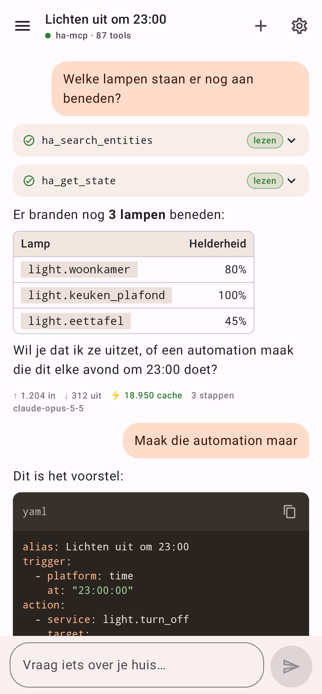
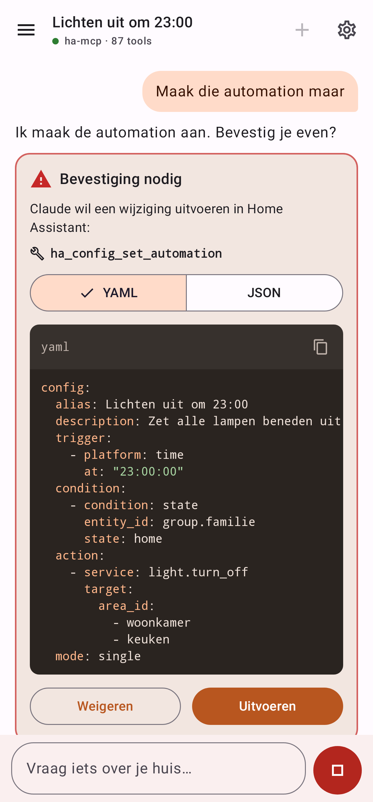
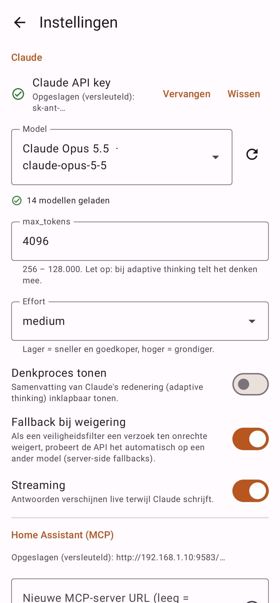
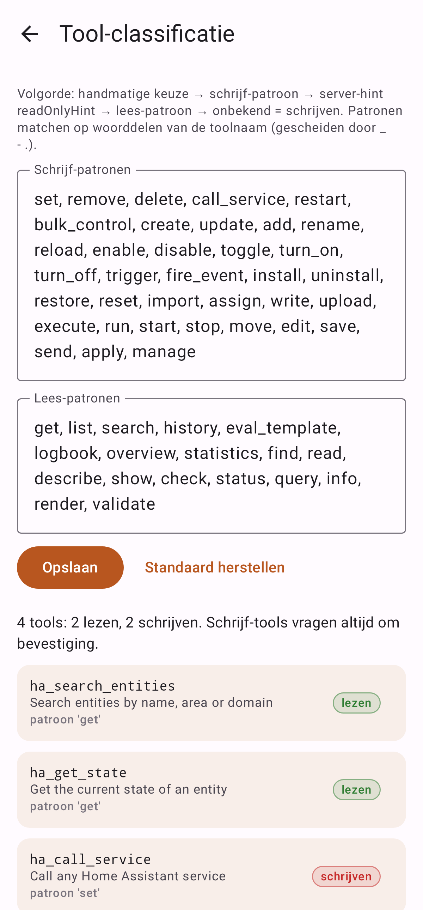

# AKO HA Chat

Android-app (Kotlin · Jetpack Compose · Material 3 · minSdk 29) om in gewone taal met je Home Assistant
te praten, via Claude en de [ha-mcp](https://github.com/homeassistant-ai/ha-mcp)-server. De app is zelf de
MCP-client, zodat de MCP-server gewoon op je LAN/VPN kan blijven staan en nooit publiek hoeft te zijn.

| Chat | Bevestiging | Instellingen | Tools |
|---|---|---|---|
|  |  |  |  |

*De screenshots worden door de tests zelf gemaakt (Robolectric + Roborazzi), zie [Screenshots bijwerken](#screenshots-bijwerken).*

---

## Hoe het werkt

```
 ┌──────────── telefoon ─────────────┐        HTTPS          ┌─────────────────────┐
 │  Chat UI ─ ChatViewModel           │ ───────────────────▶ │ api.anthropic.com    │
 │              │                     │  Messages API + SSE   │ (Claude)             │
 │          AgentLoop ── ClaudeApi ───┘                       └─────────────────────┘
 │              │
 │          ToolExecutor (McpClient)  │   HTTP op LAN/VPN     ┌─────────────────────┐
 │              └─────────────────────┼─────────────────────▶ │ ha-mcp add-on :9583  │
 └────────────────────────────────────┘  JSON-RPC, Streamable │ /private_<geheim>    │
                                          HTTP                 └─────────────────────┘
```

1. **Verbinden** – `initialize` → `notifications/initialized` → `tools/list` (met paginatie). De
   `Mcp-Session-Id` wordt bewaard; bij een verlopen sessie (404, bv. na herstart van de add-on)
   initialiseert de client automatisch opnieuw. Antwoorden mogen `application/json` of
   `text/event-stream` zijn.
2. **Conversie** – MCP-tools → Anthropic tool-definities (`name`, `description`, `input_schema`).
   Namen worden gesaneerd naar `^[a-zA-Z0-9_-]{1,64}$` met een mapping terug, en de lijst wordt
   op naam gesorteerd zodat de prompt-cache stabiel blijft.
3. **Agent-loop** – historie + tools naar Claude; bij `stop_reason: "tool_use"` alle `tool_use`-blokken
   uitvoeren via `tools/call` en de `tool_result`s (samen, in één bericht) terugsturen. Maximaal
   **15 iteraties** per beurt.
4. **Prompt caching** – `cache_control` op de laatste tool, de system prompt én het laatste bericht,
   zodat de (grote) toollijst en de groeiende historie uit de cache komen. Het effect zie je per beurt
   onder het antwoord (⚡ cache).

### Veiligheid

* **Lezen vs. schrijven** – elke tool wordt geclassificeerd (eerste match wint):
  handmatige keuze → schrijf-patroon (`set`, `remove`, `delete`, `call_service`, `restart`,
  `bulk_control`, …) → MCP-hint `readOnlyHint` → lees-patroon (`get`, `list`, `search`, `history`,
  `eval_template`, …) → **onbekend = schrijven**. Patronen matchen op woorddelen (`set` matcht
  `ha_config_set_automation`, niet `ha_reset_x`). Patronen en per-tool overrides zijn instelbaar.
* **Bevestiging** – schrijf-tools vragen *altijd* eerst om bevestiging via een kaart met toolnaam en
  argumenten (automations/scripts standaard als YAML, schakelbaar naar JSON). *Weigeren* stuurt een
  `tool_result` met `is_error: true` en "Gebruiker heeft geweigerd" naar Claude.
* **Lees-modus** – schrijf-tools worden niet eens naar Claude gestuurd. Vraagt Claude er toch één aan,
  dan wordt die geweigerd zonder uitvoering.
* **Geheimen** – API key, MCP-URL (bevat `private_<secret>`) en de optionele extra header worden met
  AES-256-GCM (Tink) versleuteld; de sleutel staat niet-exporteerbaar in de Android Keystore. Na
  opslaan toont de app alleen een hint. Er is geen HTTP-logging, foutmeldingen worden geschoond van
  geheimen, en backups zijn uitgeschakeld.
* **Netwerk** – `network_security_config` kan geen IP-ranges uitdrukken, daarom dwingt
  `CleartextPolicy` (op de enige OkHttp-client) af dat `http://` alleen mag naar privé-adressen:
  10/8, 172.16/12, 192.168/16, **100.64/10 (Tailscale)**, 127/8, 169.254/16, fc00::/7, fe80::/10 en
  `*.local`/`*.lan`/`*.home.arpa`. Hostnamen moeten volledig naar privé-adressen resolven. Anthropic
  is HTTPS-only; alleen systeem-CA's worden vertrouwd.
* **Geldige historie, altijd** – na Stop, fouten of weigeringen krijgt elk `tool_use` een
  `tool_result`, en de historie wordt alleen aangevuld, nooit herschreven. Daardoor blijven ook
  de thinking-blokken van nieuwere modellen geldig (preserved thinking).

### Claude API-details

* Directe `POST /v1/messages` met `anthropic-version: 2023-06-01`, streaming via SSE.
  De app stuurt geen sampling-parameters, dus ook `2026-10-21` zou werken (één constante in
  `AnthropicClient`).
* **Modellijst** via `GET /v1/models` (gepagineerd). De `capabilities` bepalen of `effort` en
  adaptive thinking worden meegestuurd: een model dat iets niet ondersteunt krijgt het niet.
  Standaardmodel: `claude-opus-5-5`.
* **Retry/backoff** bij 429/529/5xx/netwerkfouten (respecteert `retry-after`, anders 2-4-8 s), maar
  alleen zolang er nog niets gestreamd is: dan krijg je geen dubbele tekst.
* **Refusal-fallback** (instelbaar, standaard aan): voor modellen die het ondersteunen gaat
  `fallbacks: "default"` mee (beta `server-side-fallback-2026-07-01`). Een wissel zie je in de chat.
  Na een wissel worden alleen tool-calls van het fallback-model uitgevoerd.
* `eager_input_streaming` op de tools; afgekapte of ongeldige tool-JSON wordt **niet** uitgevoerd
  maar teruggemeld als `INVALID_JSON`. Afgekapte invoer bij `max_tokens` evenmin.
* `stop_reason: "refusal"` wordt netjes gemeld en de gedeeltelijke output komt niet in de historie.

> **Tip:** `max_tokens` staat standaard op 4096. Nieuwere modellen denken altijd mee (adaptive thinking)
> en dat telt mee voor `max_tokens`. Krijg je "Antwoord afgekapt", zet het dan op 8000-16000.

### Foutmeldingen

| Situatie | Melding |
|---|---|
| 401 | Ongeldige API key (401). Controleer je key in Instellingen. |
| 429 | Rate limit, automatische nieuwe poging met aftelling; daarna *Opnieuw*-knop |
| 529 / 5xx | Overbelast / serverfout, automatische retry |
| MCP onbereikbaar | MCP-server onbereikbaar (http://192.168.1.10:9583/…). **Niet thuis? Zet VPN aan.** |
| 401/403/404 van MCP | Uitleg of het geheime pad of de header klopt |
| http:// naar internet | Geweigerd: alleen toegestaan binnen je eigen netwerk/VPN |

---

## Projectstructuur

```
app/src/main/java/nl/ako/hachat/
├── core/            CleartextPolicy, SseReader, YamlWriter, Redaction, JSON-helpers
├── data/
│   ├── anthropic/   AnthropicClient (Messages API, SSE, retry), MessageAccumulator, fouten
│   ├── mcp/         McpClient (Streamable HTTP JSON-RPC), McpRepository (status + ToolExecutor)
│   ├── settings/    SettingsRepository (DataStore), TinkSecretCipher (Keystore)
│   ├── db/          Room: gesprekken + berichten (exacte API-content)
│   └── chat/        ChatRepository
├── domain/          AgentLoop, RequestBuilder (caching), ToolConverter, ToolClassifier, FallbackEcho
├── ui/
│   ├── chat/        ChatScreen/ChatContent, ChatViewModel, ChatItemMapper
│   ├── settings/    Instellingen + tool-classificatie
│   ├── markdown/    Eigen Markdown-parser + renderer (tabellen, code, lijsten, links)
│   └── components/  Codeblok (kopieerknop + YAML/JSON-kleuring), tool-kaarten, bevestiging
└── di/              Hilt-module
```

MVVM met Hilt, Coroutines/Flow en kotlinx.serialization. Schermen zijn stateless (`ChatContent`,
`SettingsContent`) met een action-interface, zodat ze zonder ViewModel getest kunnen worden.

**Waarom geen Kotlin MCP SDK?** Die trekt Ktor en een eigen serialization-stack mee en geeft minder
grip op foutafhandeling en het schonen van geheimen. Het benodigde deel van het protocol is klein en is
hier volledig getest tegen een gesimuleerde ha-mcp (JSON én SSE, sessie-verloop, paginatie).

**Waarom geen Anthropic SDK?** Er is geen officiële Kotlin/Android-SDK zonder JVM-zwaarte die streaming
met tool-use zo fijnmazig laat afhandelen; de Messages API is direct aangesproken via OkHttp.

---

## Bouwen en installeren

### Vereisten

* JDK 17 of nieuwer (getest met 21)
* Android SDK met platform 35 (`ANDROID_HOME` of `local.properties` met `sdk.dir=…`)

### 1. Keystore aanmaken (eenmalig)

```bash
keytool -genkeypair -v -keystore ako-ha-chat.jks -alias ako -keyalg RSA -keysize 4096 -validity 10000
```

Bewaar dit bestand en de wachtwoorden goed: zonder dezelfde keystore kun je geen updates over een
bestaande installatie heen zetten. `*.jks` staat in `.gitignore`.

### 2. Signing configureren

Maak `keystore.properties` in de projectroot (ook genegeerd door git):

```properties
storeFile=ako-ha-chat.jks
storePassword=…
keyAlias=ako
keyPassword=…
```

Of gebruik de omgevingsvariabelen `AKO_KEYSTORE_FILE`, `AKO_KEYSTORE_PASSWORD`, `AKO_KEY_ALIAS` en
`AKO_KEY_PASSWORD`. Zonder signing levert `assembleRelease` een unsigned APK op.

### 3. Bouwen

```bash
./gradlew assembleRelease
```

Resultaat: `app/build/outputs/apk/release/app-release.apk` (~3,5 MB, verkleind met R8).

### 4. Installeren

Zet USB-debugging aan op de telefoon en:

```bash
adb install -r app/build/outputs/apk/release/app-release.apk
```

Of kopieer de APK naar de telefoon en open hem (sta "installeren uit onbekende bronnen" toe).

### 5. Instellen in de app

1. **Instellingen → Claude API key** plakken en opslaan. De modellijst laadt automatisch.
2. **MCP-server URL**: `http://<ip-van-HA>:9583/private_<secret>` (zie de add-on-log van ha-mcp)
   → *Test verbinding* toont bijvoorbeeld "Verbonden met ha-mcp — 87 tools (52 lezen, 35 schrijven)".
3. Optioneel: kijk bij **Tool-classificatie** of alles klopt.

---

## Tests

```bash
./gradlew testDebugUnitTest
```

79 JVM-tests, onder andere:

* **AgentLoopTest**: gemockte Claude-API en MCP: tool-ronde, bevestigen/weigeren
  (`is_error` + "Gebruiker heeft geweigerd"), parallelle calls in één bericht, lees-modus, max. 15
  iteraties, annuleren tijdens bevestiging (historie blijft geldig), refusal, `max_tokens`,
  `INVALID_JSON`, cache-breakpoints, preserved thinking, fallback-gedrag
* **ToolConverterTest / ToolClassifierTest**: MCP → Anthropic en lezen/schrijven
* **AnthropicClientTest** (MockWebServer): SSE-opbouw incl. thinking-signatures en tool-JSON,
  429 met `retry-after`, backoff bij 529, 401, fout midden in een stream, modellijst-paginatie
* **McpClientTest** (gesimuleerde ha-mcp): sessie-id, JSON en SSE, paginatie, sessie-herstel,
  headers, onbereikbaar plus VPN-hint zonder het geheime pad te lekken
* CleartextPolicy, YAML (o.a. `"23:00:00"` correct gequote), Markdown, SSE-parser, ChatItemMapper
* **ScreenshotTest**: rendert alle schermen in Robolectric (rook-test)

### Screenshots bijwerken

```bash
./gradlew testDebugUnitTest --tests '*ScreenshotTest*' -Pscreenshots
```
